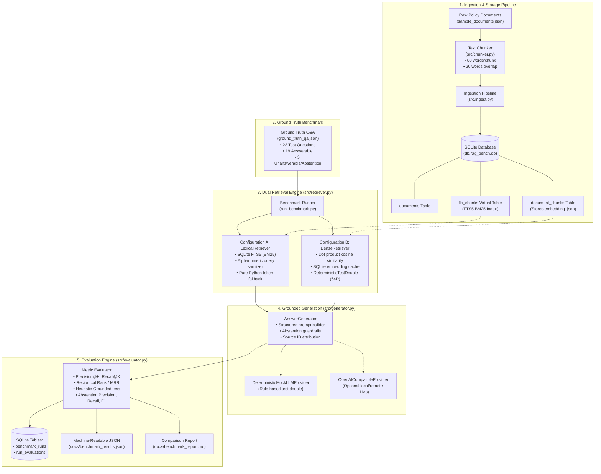

# System Architecture: DAI-009 RAG Answer Quality Benchmark

## 1. Overview and High-Level Architecture

The **DAI-009 RAG Answer Quality Benchmark** is a modular, transparent, and reproducible evaluation harness built using **Python** and **SQLite**. It benchmarks retrieval quality and answer groundedness across two distinct retrieval paradigms:
- **Configuration A: Lexical Retrieval** (SQLite FTS5 full-text search with BM25 ranking)
- **Configuration B: Dense Vector Retrieval** (Cosine similarity with cached embeddings)

The system enforces strict context-grounded answer generation, rejects hallucinations on out-of-domain queries via automated abstention, logs all experiment metrics into relational SQLite tables, and produces both machine-readable JSON results and human-readable Markdown reports.

---

## 2. End-to-End Architecture Diagram



---

## 3. Component Responsibilities

| Component | File Path | Core Responsibility |
| :--- | :--- | :--- |
| **Database Layer** | [`db/database.py`](file:///c:/Users/ankit/Desktop/Rag-Answer-Quality/db/database.py) | Manages SQLite connection lifecycle, enforces `PRAGMA foreign_keys = ON;`, handles directory auto-creation, sets `Row` factory, and runs schema DDL. |
| **Schema Definition** | [`db/schema.sql`](file:///c:/Users/ankit/Desktop/Rag-Answer-Quality/db/schema.sql) | DDL defining `documents`, `document_chunks`, `fts_chunks` (FTS5 virtual table), `benchmark_runs`, `run_evaluations`, and synchronization triggers. |
| **Chunking Engine** | [`src/chunker.py`](file:///c:/Users/ankit/Desktop/Rag-Answer-Quality/src/chunker.py) | Splits text using word-boundary preservation, sliding-window overlap, strict parameter validation (`chunk_size > 0`, `0 <= overlap < chunk_size`), and returns structured `TextChunk` records. |
| **Ingestion Pipeline** | [`src/ingest.py`](file:///c:/Users/ankit/Desktop/Rag-Answer-Quality/src/ingest.py) | Loads `sample_documents.json`, segments each document, and writes rows idempotently (`INSERT OR REPLACE` / clean re-chunking) into SQLite. |
| **Embedding Engine** | [`src/embeddings.py`](file:///c:/Users/ankit/Desktop/Rag-Answer-Quality/src/embeddings.py) | Abstract `BaseEmbeddingModel`, `DeterministicTestDoubleEmbeddingModel` (seeded 64-dimensional offline projection matrix), and optional `SentenceTransformerEmbeddingModel` with setup error diagnostics. |
| **Retrieval Engine** | [`src/retriever.py`](file:///c:/Users/ankit/Desktop/Rag-Answer-Quality/src/retriever.py) | Shared `BaseRetriever` and `RetrievalResult` interface implementing `LexicalRetriever` (SQLite FTS5 BM25) and `DenseRetriever` (vector cosine similarity with SQLite vector cache). |
| **Generation Layer** | [`src/generator.py`](file:///c:/Users/ankit/Desktop/Rag-Answer-Quality/src/generator.py) | Constructs context-grounded prompts with source metadata, provides `DeterministicMockLLMProvider` and `OpenAICompatibleProvider`, and enforces abstention safeguards. |
| **Evaluation Engine** | [`src/evaluator.py`](file:///c:/Users/ankit/Desktop/Rag-Answer-Quality/src/evaluator.py) | Implements mathematical formulations for Precision@K, Recall@K, MRR, Abstention confusion matrix (Precision, Recall, F1), and heuristic token-containment Groundedness. |
| **Benchmark Runner** | [`src/benchmark_runner.py`](file:///c:/Users/ankit/Desktop/Rag-Answer-Quality/src/benchmark_runner.py) | Coordinates end-to-end evaluation runs across both retrievers, saves runs into SQLite, and exports JSON and Markdown comparison reports. |

---

## 4. Data Flow

1. **Ingestion Flow**:
   - `data/sample_documents.json` (11 policy documents) $\rightarrow$ `src/chunker.py` (chunk size: 80 words, overlap: 20 words) $\rightarrow$ `src/ingest.py` $\rightarrow$ SQLite `documents` and `document_chunks` (22 chunks) $\rightarrow$ SQLite trigger syncs `fts_chunks`.
2. **Retrieval Flow**:
   - User query $\rightarrow$ `LexicalRetriever` (sanitizes tokens $\rightarrow$ queries FTS5 table with BM25 scoring) OR `DenseRetriever` (computes query vector $\rightarrow$ dot-product matrix multiplication against cached SQLite embeddings) $\rightarrow$ Top-$K$ `RetrievalResult` objects.
3. **Generation Flow**:
   - Query + Top-$K$ chunks $\rightarrow$ `build_prompt()` $\rightarrow$ `DeterministicMockLLMProvider` (extracts evidence matching question tokens; if token support is insufficient or query is out-of-domain, outputs canonical abstention message) $\rightarrow$ `GeneratedAnswer` (answer, `is_abstention`, cited chunk/doc IDs).
4. **Evaluation & Reporting Flow**:
   - Ground truth labels $\times$ predictions $\rightarrow$ IR metrics (MRR, Precision@K, Recall@K) + Generation metrics (Groundedness, Abstention F1) $\rightarrow$ Persisted in SQLite `benchmark_runs` and `run_evaluations` $\rightarrow$ Exported to `docs/benchmark_results.json` and `docs/benchmark_report.md`.

---

## 5. SQLite Persistence Design

```
   ┌────────────────────────────────────────────────────────┐
   │                       documents                        │
   ├────────────────────────────────────────────────────────┤
   │ PK: id (TEXT)                                          │
   │     title (TEXT), source (TEXT), content (TEXT)        │
   │     created_at (TIMESTAMP)                             │
   └───────────────────────────┬────────────────────────────┘
                               │ 1:N (ON DELETE CASCADE)
                               ▼
   ┌────────────────────────────────────────────────────────┐
   │                    document_chunks                     │
   ├────────────────────────────────────────────────────────┤
   │ PK: id (TEXT, e.g. DOC-IT-001_chk_00)                  │
   │ FK: document_id (TEXT -> documents.id)                 │
   │     chunk_index (INTEGER), content (TEXT)              │
   │     token_count (INTEGER), embedding_json (TEXT)       │
   │     created_at (TIMESTAMP)                             │
   └───────────────────────────┬────────────────────────────┘
                               │ Trigger Synchronized
                               ▼
   ┌────────────────────────────────────────────────────────┐
   │                       fts_chunks                       │
   │                  (FTS5 Virtual Table)                  │
   ├────────────────────────────────────────────────────────┤
   │ chunk_id UNINDEXED, document_id UNINDEXED, content     │
   └────────────────────────────────────────────────────────┘

   ┌────────────────────────────────────────────────────────┐
   │                     benchmark_runs                     │
   ├────────────────────────────────────────────────────────┤
   │ PK: id (TEXT, e.g. run_lexical_fts5_20261011_...)      │
   │     run_name (TEXT), config_name (TEXT), top_k (INT)   │
   │     total_queries (INT), started_at, completed_at      │
   │     notes (TEXT)                                       │
   └───────────────────────────┬────────────────────────────┘
                               │ 1:N (ON DELETE CASCADE)
                               ▼
   ┌────────────────────────────────────────────────────────┐
   │                    run_evaluations                     │
   ├────────────────────────────────────────────────────────┤
   │ PK: id (INTEGER AUTOINCREMENT)                         │
   │ FK: run_id (TEXT -> benchmark_runs.id)                 │
   │     query_id (TEXT), query_text (TEXT)                 │
   │     retrieved_chunk_ids_json (TEXT)                    │
   │     ground_truth_chunk_ids_json (TEXT)                 │
   │     precision_at_k (REAL), recall_at_k (REAL)          │
   │     reciprocal_rank (REAL), groundedness_score (REAL)  │
   │     answer_text (TEXT), is_abstention (INT, 0/1)       │
   │     latency_ms (REAL), created_at (TIMESTAMP)          │
   └────────────────────────────────────────────────────────┘
```
